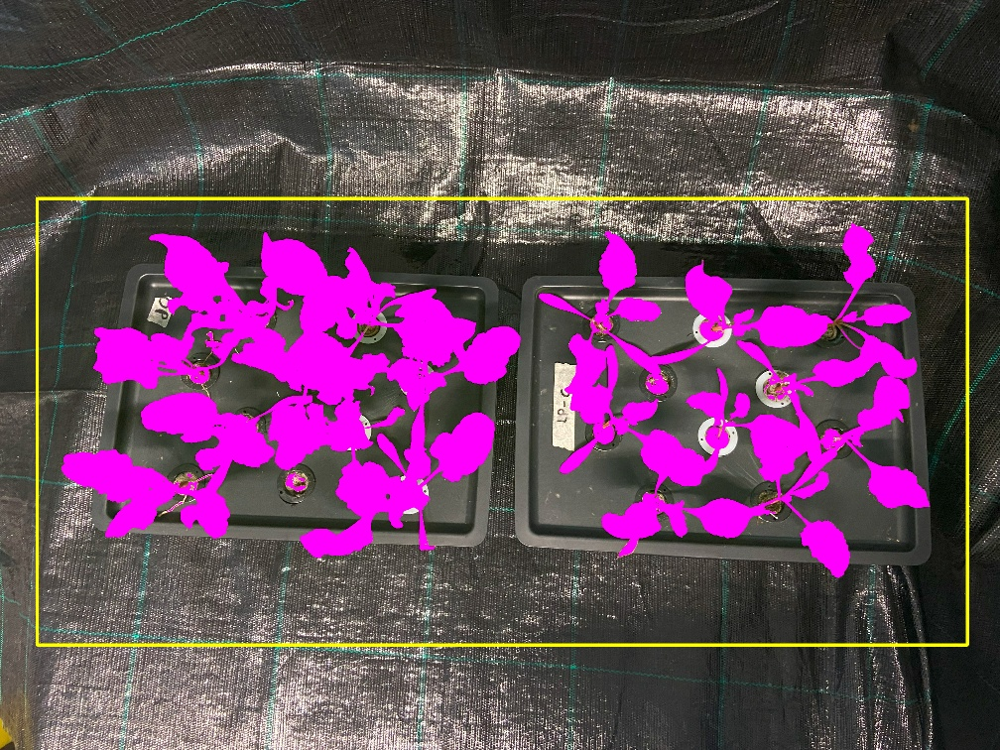
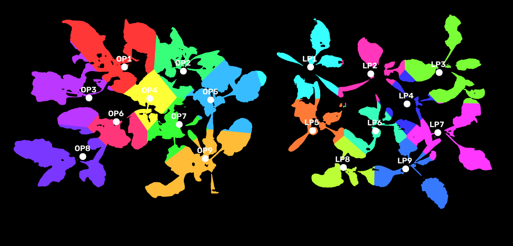
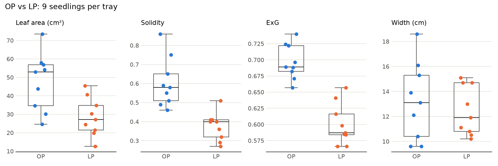
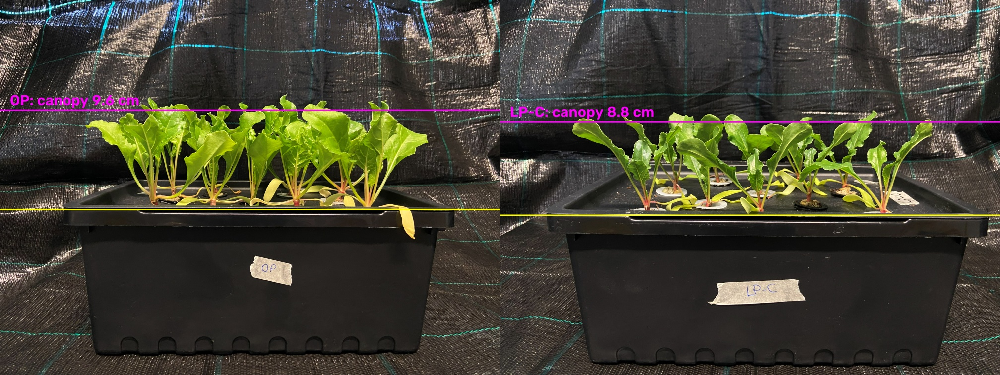
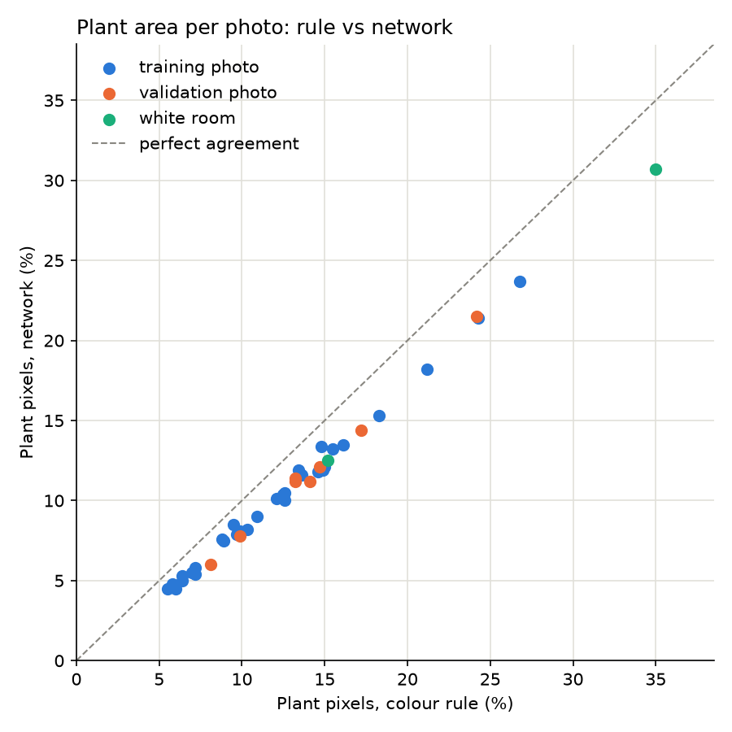

# Image-based phenotyping of phosphate-deficient seedlings

Python image analysis of smartphone photos from a hydroponic phosphate (Pi) experiment: plant segmentation, per-plant traits in real units, plant height from side views, deep-learning classification and segmentation, and an automatic folder-to-CSV pipeline.

Built as a structured self-study project in plant-phenotyping computer vision, using photos from my own experiment.



## Experiment

Seedlings grew in hydroponic boxes (rim 35 × 25 cm, 14 cm tall, 10 pots each) at five phosphate levels: P0 (0 µM Pi), LP (5), P20 (20), OP (70, optimal) and P150 (150). The results below compare one OP box and one LP box photographed on 30 April 2026 (iPhone, 4032 × 3024).

## Key results (OP vs LP, 9 plants each)

| Measure | OP | LP | OP ÷ LP |
| --- | --- | --- | --- |
| Leaf area per plant (cm², top view) | 47.6 | 28.5 | 1.67 |
| Canopy height (cm, side view) | 9.6 | 8.8 | 1.09 |
| Canopy volume, area × height (cm³) | 4,125 | 2,257 | 1.83 |
| Solidity (compactness) | 0.60 | 0.37 | 1.62 |
| ExG greenness index | 0.697 | 0.600 | 1.16 |

Low phosphate reduced leaf expansion much more than height. With one box per treatment, these results describe the two boxes; the treatment effect needs replicated boxes to be tested statistically (see [lesson 9](track1-image-analysis/module04-phenotyping/lesson09_statistics.py) on pseudo-replication).

| Per-plant assignment | Trait spread |
| --- | --- |
|  |  |



## Automatic pipeline

`pipeline/measure_folder.py` measures every photo in a folder and writes one CSV (40 photos in about 11 s on a laptop CPU).

```bash
conda env create -f environment.yml
conda activate plantvision
python pipeline/measure_folder.py data/2026-05-07
```

An optional `photo_sheet.csv` in the folder adds date, box, view and scale (`px_per_cm`); with a scale, plant area is also reported in cm². Template: [pipeline/photo_sheet_template.csv](pipeline/photo_sheet_template.csv).

| Column | Meaning |
| --- | --- |
| `plant_px` | plant pixels after segmentation |
| `plant_pct_of_photo` | plant share of the photo (%) |
| `ExG` | mean Excess Green index of plant pixels |
| `plant_cm2` | plant area in cm², when `px_per_cm` is given |

## Methods

1. **Segmentation:** G − B per pixel, Otsu threshold, morphological opening and closing, removal of blobs under 2,000 px.
2. **Individual plants:** each plant pixel assigned to its nearest pot centre.
3. **Scale:** box rim (35 × 25 cm) in the photo, about 47 px per cm.
4. **Traits:** leaf area, hue, ExG / NGRDI / GLI, perimeter, convex hull, solidity, width, senescent-tissue fraction; canopy height from side views.
5. **Deep learning (PyTorch):** ResNet-18 transfer learning for OP vs LP; LR-ASPP MobileNetV3 segmentation trained on rule-based pseudo-labels (IoU 0.81 on held-out photos), with lighting augmentation.



## What did not work, and why

- The OP/LP classifier scored 92% on held-out photos from the same room but failed on photos from a second room. It relied on the setting (background, box labels, lighting-dependent colour), and the true sample size was 5 boxes, not 56 images.
- Colour traits shift with lighting and camera white balance; compare them only within one photo or with a colour reference card.
- Top-view area underestimates tilted leaves (projected area = true area × cos(tilt)).

## Repository layout

| Folder | Contents |
| --- | --- |
| `pipeline/` | reusable folder → CSV pipeline |
| `track1-image-analysis/module01…08/` | step-by-step lessons: NumPy basics, image fundamentals, segmentation, phenotyping, DL classification, DL segmentation, growth tracking, 3D basics |
| `setup/` | environment check |
| `docs/images/` | result figures used in this README |

Raw photos (`data/`) and generated outputs (`outputs/`) are not included.
